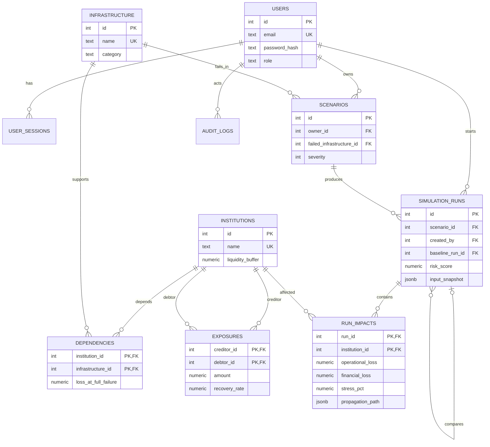

# Design and DBMS documentation

## Problem, objective, and scope

Banks rely on shared payment, clearing, cloud, and data services. A failed
service can cause an operational loss at dependent banks. A bank that exhausts
its liquidity buffer defaults, passing losses to creditors. The application
simulates that two-layer cascade on a small fictional network, then compares
the result with an extra liquidity buffer for one bank.

The network begins with six fictional banks and four services. There is one
initial service failure per scenario. This is an educational model; it neither
uses live financial data nor estimates real default probabilities.

Users can sign in as Admin or Analyst, run and search scenarios, inspect saved
impacts and paths, and compare a mitigation. Admins can edit the network,
rebuild its Neo4j projection, and inspect audit records. Analysts can view the
network and only their own runs. Admins can view all runs.

## Architecture and database choice

`Browser → Next.js interface → /api rewrite → FastAPI → PostgreSQL + Neo4j`

PostgreSQL is the source of truth for users, services, banks, dependencies,
exposures, scenarios and durable results. Foreign keys, checks and transactions
protect consistency. Neo4j is a projection of the network: its relationships
are traversed during simulation and queried for dependency counts, exposure
totals and candidate paths. Python contains the deterministic cascade rules.
Next.js renders forms, tables, a small SVG network and comparison results.

After any Admin edit, the SQL network changes and its fingerprint no longer
matches the Neo4j version. New simulations are rejected until the Admin
rebuilds the graph. The rebuild affects only nodes with this project's labels
and verifies record counts before committing. PostgreSQL and Neo4j do not share
a transaction. A PostgreSQL advisory transaction lock serializes edits, graph
rebuilds and new runs, so one simulation cannot read a mixture of versions.
Saved comparisons reuse their original input snapshot, so a
later network edit cannot change the meaning of an earlier run.

## ER diagram

`USER_SESSIONS` stores a hash of a random session token and its expiry;
`AUDIT_LOGS` stores who changed an institution or service and the old/new
JSON values. The full relational schema, types and constraints are in
[`sql/schema.sql`](../sql/schema.sql).

## Data dictionary and integrity

| Field | Meaning | Database rule |
|---|---|---|
| `institutions.liquidity_buffer` | Resources available to absorb loss | Positive numeric |
| `dependencies.loss_at_full_failure` | Direct bank loss at 100% service severity | Non-negative numeric, unique bank/service edge |
| `exposures.amount` | Creditor's claim on debtor | Non-negative numeric, unique directed pair, no self-edge |
| `exposures.recovery_rate` | Fraction of an exposure recovered after default | 0–1 |
| `scenarios.severity` | Fraction of full service failure | Integer 0–100 |
| `run_impacts.first_affected_round` | 0 for direct operational loss, 1+ for contagion | Non-negative when present |
| `run_impacts.stress_pct` | Total loss / buffer, capped at 100% | 0–100 |
| `simulation_runs.input_snapshot` | Original network, service, severity, formula version and optional mitigation | JSONB, saved with run |

Foreign keys reject references to missing banks/services/users. Referential
restrictions prevent deleting master data already used by saved scenarios or
impacts. Form and API validation provide friendly messages; SQL constraints
remain the final integrity boundary.

## Neo4j model and retrieval

- `(:RiskInstitution {id, name})`
- `(:RiskInfrastructure {id, name})`
- `(creditor)-[:EXPOSED_TO {amount, recovery_rate}]->(debtor)`
- `(bank)-[:DEPENDS_ON {loss}]->(service)`
- `(:RiskNetworkVersion {fingerprint})` records the SQL snapshot version.

Unique constraints index both node IDs. To propagate a service failure, query
incoming `DEPENDS_ON` edges. To propagate a debtor default, query incoming
`EXPOSED_TO` edges. Cypher `count()` ranks services by dependents and `sum()`
ranks debtor banks by exposure held by creditors. A variable-length Cypher
query retrieves candidate service-to-bank paths; the run stores the actual
path that produced a loss, and the trace API can verify that path against the
current graph. See [`cypher/demo_queries.cypher`](../cypher/demo_queries.cypher).

## Simulation rules

1. For each bank depending on the failed service, calculate
   `operational_loss = loss_at_full_failure × severity / 100`.
2. Default a bank when cumulative operational plus financial losses meet or
   exceed its buffer.
3. Each newly defaulted debtor passes
   `exposure_amount × (1 − recovery_rate)` to each creditor.
4. Group losses within a round before deciding new defaults. Process each
   default once, so cycles cannot cause repeated charges.
5. Calculate each bank's stress as
   `min(100, 100 × total_loss / liquidity_buffer)`.
6. The run risk score is the average bank stress, including zero-stress banks.
   The PostgreSQL function recalculates it from saved impacts.

At 100% Payment Rail severity, Bank A loses 120 against a buffer of 100 and
defaults. Bank B has an 80 exposure to A at 25% recovery and loses 60 against
its buffer of 50, so it defaults. Bank C then loses 72 but has a buffer of 75.
The two defaults and six-bank average stress of 49.33% can be calculated by
hand. Adding 20 to B's buffer prevents B's default and its onward loss to C.

## Advanced concepts and query evidence

| Requirement | Code/evidence |
|---|---|
| SQL transaction | `backend.db.connect` commits complete runs and rolls back exceptions; `backend.runs.save_result` inserts run and impacts together. |
| SQL view | `v_run_summary` drives dashboard/history queries. |
| SQL stored function | `calculate_systemic_risk(run_id)` sets the saved score after impact insertion. |
| SQL trigger | `audit_master_data()` records institution/service changes and actor ID. |
| SQL indexing | Indexes support run history, owner filtering, exposure lookup, sessions and audit history. |
| NoSQL aggregation | `backend.graph.network_analysis` uses Cypher `count()` and `sum()` for the Network screen. |

[`sql/demo_queries.sql`](../sql/demo_queries.sql) also demonstrates CREATE,
ALTER, DROP, INSERT, UPDATE, DELETE, SELECT, JOIN, GROUP BY, HAVING,
ORDER BY, aggregates and a subquery. The DDL/DML demonstration uses a
temporary table; its final transaction deliberately rolls back.

## Security and roles

Passwords use salted PBKDF2-SHA256 hashes. Login creates a random token;
only its SHA-256 hash is stored in PostgreSQL. The browser receives an
HttpOnly SameSite cookie with an eight-hour expiry. Set `COOKIE_SECURE=true`
when serving over HTTPS. All write routes check the role in FastAPI; run
routes also check scenario ownership. Database URLs and credentials live in
`.env`, which Git ignores. SQL and Cypher values use parameters.

## Limitations and future work

The risk score is intentionally simple, and the synthetic amounts do not
represent actual institutions. There is no live data, recovery timeline,
multi-service initial failure, or probability model. A future version could
model recovery times and validate the assumptions against external data.
Full-system test results and application screenshots remain to be captured
after the local databases and web app are run together.
